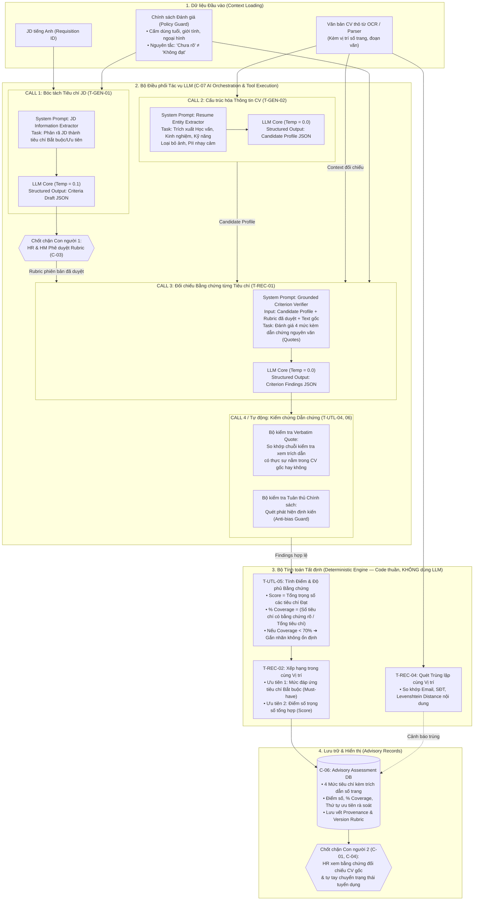

# THIẾT KẾ KIẾN TRÚC ĐIỀU PHỐI & GỌI MÔ HÌNH NGÔN NGỮ LỚN (LLM ORCHESTRATION ARCHITECTURE)

> **Cập nhật migration 00019:** Các hướng dẫn bật/tắt bằng biến môi trường trong tài liệu lịch sử bên dưới không áp dụng cho worker mới. Xem [AI_ADMIN_ROUTING_STATUS.md](AI_ADMIN_ROUTING_STATUS.md) về database control, giới hạn OFF và rollout/rollback không mixed-version. Chưa triển khai thay đổi này lên môi trường thật.

> **Lưu ý triển khai (05/11/2026):** Tài liệu này mô tả yêu cầu/thiết kế mục tiêu, không phải xác nhận các chức năng đã nghiệm thu. Trạng thái mã, giới hạn privacy/recovery và trạng thái migration trên project Supabase kết nối được theo dõi tại [PHASE1_GAP_ANALYSIS.md](../audit/PHASE1_GAP_ANALYSIS.md) và [DEPLOYMENT.md](../DEPLOYMENT.md).
## Dự án: VinUni AI-Native CV Matching & Ranking (HRA)

> **Cập nhật triển khai (07/11/2026):** pipeline hiện tại chạy deterministic rule engine trước; LLM chỉ fallback cho tiêu chí chưa quyết định. pgvector/BGE semantic retrieval và LTR đã có trong mã nhưng tắt mặc định và không thay thế LLM/rule/score. Nguồn sự thật về luồng hiện tại, fingerprint và gate nằm ở [MATCHING_STABILITY.md](MATCHING_STABILITY.md).

| Thuộc tính | Giá trị chuẩn hóa |
|---|---|
| **Tên tài liệu** | Đặc tả Kiến trúc Điều phối & Luồng Gọi LLM (LLM Architecture & Prompt Pipeline Specification) |
| **Phiên bản** | 1.0 — Technical Architecture Release |
| **Trạng thái** | Thiết kế Kỹ thuật Chi tiết (Detailed Technical Design) |
| **Căn cứ kế thừa** | [HRA_PRD.md](file:///d:/VinUniIT/HRA_PRD.md), [HRA_ArchitectureDesign.md](file:///d:/VinUniIT/HRA_ArchitectureDesign.md), [HRA_Phase1_Architecture.md](file:///d:/VinUniIT/HRA_Phase1_Architecture.md) |
| **Phạm vi kỹ thuật** | Tầng xử lý AI (`C-07`, `C-08`), Điều phối LLM, Ép kiểu cấu trúc (Structured Output), Bộ tính toán tất định |
| **Tôn chỉ cốt lõi** | **Chống ảo giác (Anti-hallucination)**, **Minh bạch dẫn chứng từng câu chữ (Grounding with Evidence)**, **Con người nắm toàn quyền quyết định (Human-in-control)** |

---

## 1. Tổng quan Triết lý Kiến trúc Gọi LLM (Core Design Philosophy)

Để giải quyết bài toán sàng lọc và xếp hạng ứng viên của VinUni một cách tin cậy và không thiên lệch, **hệ thống KHÔNG sử dụng một câu lệnh nguyên khối (Monolithic Prompt) dạng "hộp đen"** (như đưa toàn bộ JD và CV vào rồi yêu cầu LLM chấm điểm đỗ/trượt).

Thay vào đó, kiến trúc LLM được thiết kế theo các nguyên tắc kỹ thuật chuẩn mực:

1. **Phân rã thành Chuỗi Tác vụ Chuyên biệt (Multi-Stage Task-Specific Pipeline):** Mỗi lần gọi LLM chỉ giải quyết một bài toán con duy nhất với phạm vi dữ liệu tối thiểu (Minimum Viable Context).
2. **Tách biệt LLM Trích xuất khỏi Tính toán Số học (Separation of Extraction & Calculation):** LLM chỉ chịu trách nhiệm đọc hiểu ngữ nghĩa, bóc tách thực thể và tìm dẫn chứng. Việc tính điểm số, tính tỷ lệ độ phủ và sắp xếp thứ hạng được giao hoàn toàn cho **Mã nguồn thuật toán tất định (Deterministic Code)** để triệt tiêu 100% ảo giác số học.
3. **Ép kiểu Cấu trúc Tuyệt đối (Strict Schema Enforcement):** 100% đầu ra của LLM phải tuân thủ JSON Schema (thông qua Guided Decoding của vLLM hoặc Pydantic Validation). Nếu sai cú pháp hoặc thiếu trường, hệ thống kích hoạt cơ chế tự động sửa lỗi (Self-healing Retry).
4. **Kiểm chứng Dẫn chứng Nguyên văn (Verbatim Grounding Verification):** Mọi nhận định đánh giá đều phải kèm theo đoạn trích xuất nguyên văn (`verbatim_quote`) và số trang. Mã nguồn hệ thống sẽ so khớp chuỗi (String Matching) trực tiếp trên file gốc để xác thực tính có thật của bằng chứng.

---

## 2. Sơ đồ Kiến trúc Điều phối & Luồng Gọi LLM (LLM Orchestration Diagram)



---

## 3. Đặc tả Chi tiết các Lần gọi LLM (Detailed LLM Calls & Schemas)

---

### Lần gọi 1: Bóc tách & Chuẩn hóa Tiêu chí từ JD (`T-GEN-01`)
* **Thời điểm kích hoạt:** Khi Recruiter tạo vị trí tuyển dụng và tải file mô tả công việc (JD tiếng Anh).
* **Mục tiêu:** Bóc tách các yêu cầu văn bản tự do thành danh sách các tiêu chí đo lường được, phân định rõ ràng giữa yêu cầu bắt buộc và ưu tiên.
* **Cấu hình mô hình:** `temperature = 0.1`, `top_p = 0.95`, `response_format = {"type": "json_object"}`.

#### System Prompt:
```text
You are an expert HR Recruitment Assistant specialized in job description decomposition.
Your task is to analyze the provided English Job Description (JD) and extract explicit, verifiable evaluation criteria.

RULES:
1. Divide criteria into two strict categories:
   - "MUST_HAVE": Non-negotiable baseline requirements (e.g. minimum years of specific experience, core programming languages, mandatory degrees).
   - "NICE_TO_HAVE": Preferred qualifications, secondary skills, or optional certifications.
2. Assign default weights: Total of all MUST_HAVE criteria = 70.0. Total of all NICE_TO_HAVE criteria = 30.0. Sum must equal 100.0.
3. For each criterion, identify 3-5 explicit evidence keywords expected in candidate resumes.
4. DO NOT invent requirements not mentioned in the JD.
5. STRICTLY FORBIDDEN: Do not generate criteria related to age, gender, marital status, nationality, appearance, or personality traits.
6. Output MUST strictly follow the provided JSON schema.
```

#### JSON Schema Đầu ra (`CriteriaDraftSchema`):
```json
{
  "$schema": "http://json-schema.org/draft-07/schema#",
  "type": "object",
  "properties": {
    "requisition_id": { "type": "string" },
    "job_title": { "type": "string" },
    "criteria": {
      "type": "array",
      "items": {
        "type": "object",
        "properties": {
          "criterion_id": { "type": "string" },
          "category": { "type": "string", "enum": ["MUST_HAVE", "NICE_TO_HAVE"] },
          "name": { "type": "string" },
          "description": { "type": "string" },
          "weight": { "type": "number", "minimum": 0, "maximum": 100 },
          "expected_evidence_keywords": {
            "type": "array",
            "items": { "type": "string" }
          }
        },
        "required": ["criterion_id", "category", "name", "description", "weight", "expected_evidence_keywords"]
      }
    }
  },
  "required": ["requisition_id", "job_title", "criteria"]
}
```

* **Chốt chặn:** Kết quả trả về được lưu dưới trạng thái `DRAFT`. Hiring Manager và HR Recruiter phải xác nhận và phê duyệt trên giao diện `C-03` trước khi chuyển sang bước sàng lọc CV.

---

### Lần gọi 2: Cấu trúc hóa Hồ sơ Ứng viên (`T-GEN-02`)
* **Thời điểm kích hoạt:** Xử lý ngay sau khi một tệp CV được bộ chuyển đổi OCR/DOCX trích xuất văn bản thô kèm siêu dữ liệu số trang.
* **Mục tiêu:** Chuyển văn bản phi cấu trúc thành dữ liệu thực thể chuẩn hóa, loại bỏ hoàn toàn các thuộc tính nhạy cảm (Blind Resume Parsing).
* **Cấu hình mô hình:** `temperature = 0.0` (deterministic parsing).

#### System Prompt:
```text
You are a precise Resume Information Extraction Engine.
Your task is to parse unstructured CV text into a structured, verifiable profile.

STRICT PRIVACY & ANTI-BIAS RULES:
- COMPLETELY OMIT AND STRIP: Candidate photo, age, date of birth, gender, marital status, religion, ethnicity, residential address.
- Retain ONLY: Professional experience, education history, technical/soft skills, languages, and verifiable certifications.
- Record the exact page number where each block of information is located.
- Output MUST strictly adhere to the JSON schema.
```

#### JSON Schema Đầu ra (`StructuredCandidateProfile`):
```json
{
  "$schema": "http://json-schema.org/draft-07/schema#",
  "type": "object",
  "properties": {
    "candidate_identifier": { "type": "string" },
    "total_years_experience": { "type": "number" },
    "education": {
      "type": "array",
      "items": {
        "type": "object",
        "properties": {
          "degree": { "type": "string" },
          "institution": { "type": "string" },
          "major": { "type": "string" },
          "graduation_year": { "type": "string" },
          "page_number": { "type": "integer" }
        },
        "required": ["degree", "institution", "page_number"]
      }
    },
    "work_history": {
      "type": "array",
      "items": {
        "type": "object",
        "properties": {
          "company": { "type": "string" },
          "role": { "type": "string" },
          "duration": { "type": "string" },
          "responsibilities_and_achievements": { "type": "string" },
          "page_number": { "type": "integer" }
        },
        "required": ["company", "role", "duration", "page_number"]
      }
    },
    "skills": {
      "type": "array",
      "items": { "type": "string" }
    },
    "certifications": {
      "type": "array",
      "items": {
        "type": "object",
        "properties": {
          "name": { "type": "string" },
          "issuer": { "type": "string" },
          "year": { "type": "string" },
          "page_number": { "type": "integer" }
        },
        "required": ["name", "page_number"]
      }
    }
  },
  "required": ["candidate_identifier", "total_years_experience", "education", "work_history", "skills", "certifications"]
}
```

---

### Lần gọi 3: Đối chiếu Bằng chứng từng Tiêu chí (`T-REC-01`)
* **Thời điểm kích hoạt:** Khi hệ thống tiến hành đối chiếu một CV cụ thể với Bộ Rubric đã được phê duyệt.
* **Mục tiêu:** Nhận định mức độ đáp ứng của ứng viên đối với từng tiêu chí, kèm theo **đoạn trích dẫn nguyên văn (verbatim quote)** làm chứng cứ.
* **Cấu hình mô hình:** `temperature = 0.0`.

#### System Prompt:
```text
You are a rigorous, evidence-based Candidate Verification Agent.
You will be provided with:
1. The APPROVED RUBRIC (list of criteria with descriptions and category).
2. The STRUCTURED CANDIDATE PROFILE and the RAW CV TEXT with page offsets.

EVALUATION RULES:
1. For each criterion, assign exactly ONE of the following 4 levels:
   - "STRONG_MATCH": Candidate substantially exceeds the requirement with verifiable metrics.
   - "MATCH": Candidate explicitly satisfies the full requirement.
   - "UNCLEAR": The CV does not mention the requirement, or mentions it ambiguously without verifiable context.
   - "NO_MATCH": The CV provides explicit evidence contradicting the requirement (e.g. requires 5 years, CV explicitly shows 1 year total).
2. CRITICAL PRINCIPLE: "UNCLEAR" MUST NEVER BE TREATED AS "NO_MATCH". If evidence is absent, you MUST output "UNCLEAR".
3. EVIDENCE REQUIREMENT:
   - For "STRONG_MATCH" and "MATCH", you MUST provide an exact, verbatim text quote copied directly from the CV and its page number.
   - If no verbatim quote exists in the text, you CANNOT assign "MATCH" or "STRONG_MATCH".
4. Reasoning must be concise, objective, and neutral. Do not assume or extrapolate.
```

#### JSON Schema Đầu ra (`CriterionFindingsSchema`):
```json
{
  "$schema": "http://json-schema.org/draft-07/schema#",
  "type": "object",
  "properties": {
    "candidate_identifier": { "type": "string" },
    "rubric_version": { "type": "string" },
    "findings": {
      "type": "array",
      "items": {
        "type": "object",
        "properties": {
          "criterion_id": { "type": "string" },
          "status": {
            "type": "string",
            "enum": ["STRONG_MATCH", "MATCH", "UNCLEAR", "NO_MATCH"]
          },
          "reasoning": { "type": "string" },
          "evidence": {
            "type": ["object", "null"],
            "properties": {
              "verbatim_quote": { "type": "string" },
              "page_number": { "type": "integer" }
            },
            "required": ["verbatim_quote", "page_number"]
          }
        },
        "required": ["criterion_id", "status", "reasoning", "evidence"]
      }
    }
  },
  "required": ["candidate_identifier", "rubric_version", "findings"]
}
```

---

### Lần gọi 4 (Tự động): Kiểm chứng Dẫn chứng & Lọc Định kiến (`T-UTL-04, 06`)
* **Cơ chế thực thi:** Chạy kết hợp giữa script Python (String Matching) và Prompt Guardrail:
  1. **Grounding Validator (`T-UTL-04`):**
     * Nhận `verbatim_quote` từ LLM 3.
     * Kiểm tra chuỗi con (Exact substring hoặc Fuzzy match với ngưỡng tương đồng $\ge 95\%$) trên văn bản trang tương ứng của CV gốc.
     * *Nếu không tìm thấy chuỗi trong trang:* Hệ thống đánh dấu cờ lỗi trích dẫn (Citation Flag) và tự động hạ cấp tiêu chí đó về trạng thái `UNCLEAR`, kèm thông báo cho HR: *"Dẫn chứng AI trích xuất không khớp nguyên văn CV gốc"*.
  2. **Anti-Bias Policy Guard (`T-UTL-06`):**
     * Quét phân tích đoạn văn `reasoning` của LLM. Nếu phát hiện các từ khóa hoặc suy luận nhắc đến tuổi tác, giới tính, trường chuyên/lớp chọn không thuộc tiêu chí, bản ghi bị từ chối và ghi log cảnh báo an toàn.

---

## 4. Tầng Xử lý Tất định (Deterministic Processing Engine)

> **Nguyên tắc bất biến:** LLM **không bao giờ** được phép thực hiện phép cộng, trừ, nhân, chia điểm số hay tự quyết định vị trí thứ bậc của ứng viên.

Toàn bộ phép toán và thuật toán phân loại được viết bằng mã nguồn Python/SQL chuẩn xác 100%:

### 4.1. Công thức Tính Điểm & Độ phủ Bằng chứng (`T-UTL-05`)
1. **Điểm Matching Tổng hợp (Weighted Match Score):**
   $$\text{Score} = \sum_{i=1}^{N} \left( W_i \times S_i \right)$$
   *Trong đó:*
   * $W_i$: Trọng số của tiêu chí $i$ đã được phê duyệt trong rubric ($\sum W_i = 100.0$).
   * $S_i$: Hệ số chuẩn hóa của trạng thái tiêu chí:
     * `STRONG_MATCH`: $S_i = 1.0$
     * `MATCH`: $S_i = 1.0$ (hoặc $0.8$ tùy cấu hình rubric chuyên môn)
     * `UNCLEAR`: $S_i = 0.0$ *(không tính điểm nhưng không bị coi là vi phạm tiêu chí)*
     * `NO_MATCH`: $S_i = 0.0$

2. **Chỉ số Độ phủ Bằng chứng (Evidence Coverage):**
   $$\text{Evidence Coverage (\%)} = \frac{N_{\text{EVIDENCE\_PRESENT}}}{N_{\text{TOTAL\_CRITERIA}}} \times 100\%$$
   *Trong đó $N_{\text{EVIDENCE\_PRESENT}}$ là số lượng tiêu chí có trạng thái xác định (`STRONG_MATCH`, `MATCH`, hoặc `NO_MATCH`).*

> **Chốt chặn An toàn:**
> Nếu $\text{Evidence Coverage} < 70\%$, hệ thống tự động khóa hiển thị điểm số đơn lẻ, hiển thị nhãn cảnh báo: **"Chưa đủ dữ liệu để xếp hạng ổn định"** và đưa hồ sơ vào nhóm **Cần HR xác minh thủ công**.

---

### 4.2. Thuật toán Xếp hạng Ưu tiên Rà soát (`T-REC-02`)
Thay vì sắp xếp đơn thuần theo điểm số từ cao xuống thấp (dễ dẫn đến việc ứng viên thiếu kỹ năng bắt buộc nhưng điểm ưu tiên cao vẫn lên top), hệ thống áp dụng thuật toán **Sắp xếp Đa tầng (Multi-tier Priority Sorting)**. Bản hiện thực dùng `matching_status` làm gate đầu tiên, sau đó là score và coverage; LTR (nếu `ACTIVE` và đạt gate) chỉ chen vào giữa gate trạng thái/coverage và score như mô tả ở mục 4.5:

```python
def ranking_comparator(candidate_a, candidate_b):
    # Cấp 1: Số lượng tiêu chí BẮT BUỘC (MUST_HAVE) bị vi phạm (NO_MATCH hoặc UNCLEAR)
    # Ứng viên đáp ứng đầy đủ tiêu chí bắt buộc luôn được xếp trước
    if candidate_a.must_have_unmet != candidate_b.must_have_unmet:
        return candidate_a.must_have_unmet - candidate_b.must_have_unmet  # Càng ít vi phạm càng lên trước

    # Cấp 2: Điểm Matching Tổng hợp (Score)
    if candidate_a.score != candidate_b.score:
        return candidate_b.score - candidate_a.score  # Điểm cao hơn xếp trước

    # Cấp 3: % Độ phủ bằng chứng (Coverage)
    return candidate_b.coverage - candidate_a.coverage  # Độ phủ cao hơn xếp trước
```

### 4.3. Phân nhóm Rà soát Nghiệp vụ (Review Groups)
Hồ sơ được tự động gom vào 4 nhóm nghiệp vụ để HR ưu tiên xử lý:
1. **Nhóm 1 — Đạt tiêu chí bắt buộc (Meets Mandatory Criteria):** 100% tiêu chí bắt buộc ở mức `MATCH` hoặc `STRONG_MATCH`.
2. **Nhóm 2 — Cần HR xác minh (Needs HR Verification):** Có ít nhất một tiêu chí bắt buộc ở mức `UNCLEAR` hoặc độ phủ bằng chứng $< 70\%$.
3. **Nhóm 3 — Có dấu hiệu miss-match (Mismatch Signals):** Có ít nhất một tiêu chí bắt buộc rơi vào `NO_MATCH`.
4. **Nhóm 4 — File cần kiểm tra kỹ thuật (Technical Check Required):** Bản scan mờ, PDF khóa password, lỗi bóc tách text.

### 4.4. Semantic retrieval bằng pgvector/BGE (không phải LLM)

Khi `SEMANTIC_RETRIEVAL_ENABLED=true`, worker dùng embedding provider để tạo vector cho các chunk CV và cho query suy ra từ `requirement_spec` của tiêu chí chưa quyết định. Provider production dự kiến là BGE qua endpoint OpenAI-compatible `/embeddings`; provider `hash` chỉ phục vụ test plumbing và không có ý nghĩa chất lượng semantic.

Luồng kiểm soát:

1. Chunk CV đã redaction được embed và lưu vào `app_private.cv_chunk_embeddings` theo document/chunk/text hash/model/index version.
2. pgvector truy vấn cosine similarity trong đúng document đang đánh giá; không tìm xuyên ứng viên/vị trí.
3. Semantic chunks được merge với lexical chunks, ưu tiên chunk có cả hai nguồn, và bị giới hạn tối đa 5 chunks cho mỗi criterion trước khi gửi LLM fallback.
4. Similarity chỉ là tín hiệu retrieval. Nó không tạo finding, không cộng điểm và không thay đổi outcome của rule engine. Quote từ chunk semantic vẫn phải qua verbatim verification như chunk lexical.
5. Lỗi endpoint, dimension mismatch hoặc pgvector không sẵn sàng đều fallback về lexical/in-memory; assessment không fail chỉ vì semantic retrieval lỗi.

### 4.5. Learning-to-Rank (LTR) sau deterministic ranking

LTR không phải một lần gọi LLM và không tham gia chấm từng criterion. Đây là pairwise logistic ranker train offline từ ví dụ đã gán nhãn theo group/position, tách holdout theo nguyên group. Artifact phải đạt NDCG@10/pairwise accuracy và gate kích thước holdout mới được nạp.

- `OFF`: ranking giữ nguyên `matching_status -> matching_score -> evidence_coverage -> application_id`.
- `SHADOW`: tính và lưu `ltr_score` để đối chiếu, không đổi thứ hạng.
- `ACTIVE`: LTR chỉ reorder bên trong cùng `matching_status` và cùng coverage-eligibility gate; sau đó mới dùng score/coverage làm tie-break. LTR không giúp hồ sơ vượt `POSSIBLE_MISMATCH`, `NOT_ASSESSED` hoặc coverage dưới ngưỡng.

---

## 5. Ngăn xếp Công nghệ & Phương án Triển khai Mô hình Nội bộ

Để đáp ứng yêu cầu của [HRA_PRD.md](file:///d:/VinUniIT/HRA_PRD.md) về việc **bảo vệ bí mật thông tin và tuân thủ Nghị định 13/2023/NĐ-CP**, toàn bộ pipeline LLM được thiết kế để chạy trên hạ tầng cục bộ (On-premise / Private Cloud) của VinUni:

| Lớp kiến trúc | Công nghệ lựa chọn | Vai trò & Đặc tính kỹ thuật |
|---|---|---|
| **Mô hình Nền tảng (Foundation LLM)** | **Qwen 2.5 (14B / 32B / 72B-Instruct)** hoặc **Llama 3.3 (70B-Instruct)** | • Khả năng đọc hiểu song ngữ Anh - Việt xuất sắc.<br/>• Hỗ trợ Context Window dài (32k - 128k tokens) đủ chứa cả lô văn bản.<br/>• Tỷ lệ tuân thủ JSON Schema đạt > 99%. |
| **Hạ tầng Phục vụ Mô hình (Inference Engine)** | **vLLM (v0.6+)** | • Công nghệ PagedAttention tối ưu hóa VRAM GPU.<br/>• Hỗ trợ **Guided Decoding / Outlines Engine** ép kiểu JSON Schema trực tiếp ở tầng sinh token, loại bỏ hoàn toàn lỗi cú pháp.<br/>• Xử lý song song hàng chục CV với thông lượng (Throughput) cao. |
| **Tầng Điều phối (AI Orchestrator)** | **Python FastAPI + Pydantic v2 + Instructor** | • Đóng gói các hàm gọi tool và pipeline.<br/>• Kiểm tra kiểu dữ liệu đầu ra tự động bằng Pydantic Model.<br/>• Tự động kích hoạt cơ chế retry (tối đa 2 lần) nếu LLM không thỏa mãn validation. |
| **Hạ tầng Phần cứng Đề xuất** | **1x - 2x NVIDIA A100 (80GB) hoặc H100 (hoặc cụm 4x L40S 48GB)** | • Đủ năng lực chạy mô hình lượng tử hóa FP8 / AWQ 70B tokens với tốc độ phản hồi 30–50 tokens/giây, đáp ứng SLA xử lý batch 50 CV trong dưới 3 phút. |

---

## 6. Cơ chế Kiểm soát An toàn & Quyền Hạn (Guardrails & Governance)

```
┌────────────────────────────────────────────────────────────────────────┐
│                        HUMAN DECISION BOUNDARY                         │
│                                                                        │
│   [AI Inference & Extraction]                                          │
│              │                                                         │
│              ▼                                                         │
│   [Advisory Assessment Record] (Chỉ lưu kết quả tư vấn)                │
│              │                                                         │
│              ▼                                                         │
│   [HR Recruiter Review Screen] (Con người đối chiếu CV gốc)            │
│              │                                                         │
│              ▼                                                         │
│   [Human State Transition] ──► [Application Lifecycle DB (D5)]         │
│   (Chỉ HR mới có quyền cập     (Trạng thái chính thức:                 │
│    nhật trạng thái tuyển dụng)  Shortlist / Bị loại / Nhận việc)       │
└────────────────────────────────────────────────────────────────────────┘
```

1. **AI không bao giờ có quyền ghi vào bảng `D5` (Application Lifecycle):** LLM chỉ có quyền ghi vào bảng `D4` (`Advisory Records`). Việc chuyển trạng thái ứng viên (Shortlist, Bị loại, Phỏng vấn, Tuyển dụng) **bắt buộc phải do người dùng HR bấm nút xác nhận**.
2. **Không học lại trên dữ liệu ứng viên khi chưa cho phép:** Toàn bộ dữ liệu CV và prompt được xử lý độc lập trong bộ nhớ đệm tạm thời (Stateless Inference); không dùng dữ liệu hồ sơ thực tế để fine-tune mô hình công cộng.
3. **Bảo toàn Audit Log bất biến:** Mọi lần gọi LLM (kèm mã hash prompt, phiên bản rubric, thời gian xử lý và kết quả trích xuất) đều được ghi nhận vào bảng `D6` (Audit Log) để phục vụ thanh kiểm tra định kỳ.

