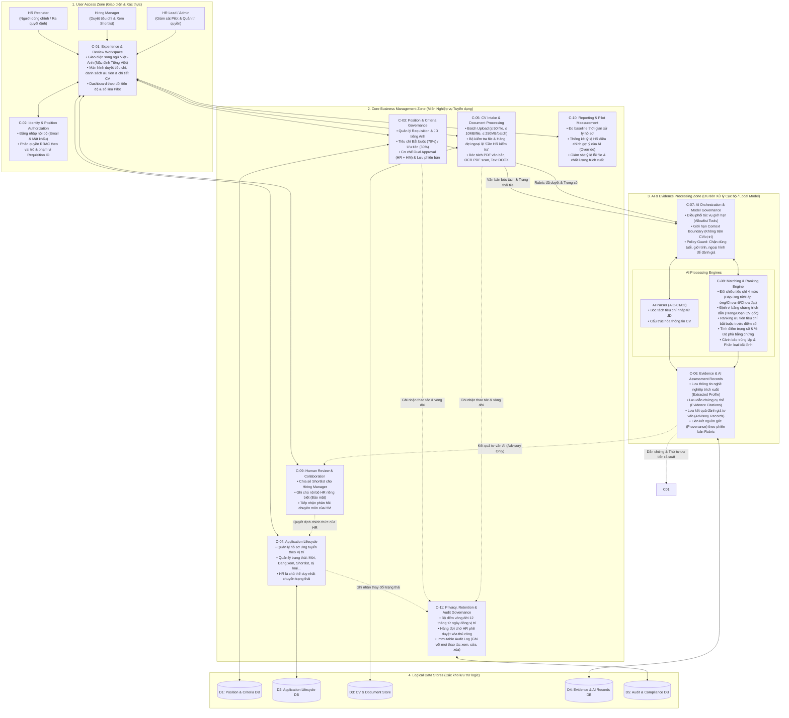
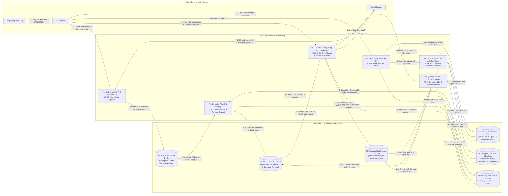

# TÀI LIỆU KIẾN TRÚC HỆ THỐNG & SƠ ĐỒ LUỒNG DỮ LIỆU — PHASE 1 (MVP PILOT)

> **Cập nhật migration 00019:** Các hướng dẫn bật/tắt bằng biến môi trường trong tài liệu lịch sử bên dưới không áp dụng cho worker mới. Xem [AI_ADMIN_ROUTING_STATUS.md](AI_ADMIN_ROUTING_STATUS.md) về database control, giới hạn OFF và rollout/rollback không mixed-version. Code `5f5c529` đã deploy VPS test theo log người dùng; chưa chứng minh production readiness.

> **Lưu ý triển khai (05/11/2026):** Tài liệu này mô tả yêu cầu/thiết kế mục tiêu, không phải xác nhận các chức năng đã nghiệm thu. Trạng thái mã, giới hạn privacy/recovery và trạng thái migration trên project Supabase kết nối được theo dõi tại [PHASE1_GAP_ANALYSIS.md](../audit/PHASE1_GAP_ANALYSIS.md) và [DEPLOYMENT.md](../DEPLOYMENT.md).
## Dự án: VinUni AI-Native CV Matching & Ranking (HRA)

| Thuộc tính | Giá trị chuẩn hóa |
|---|---|
| **Tên tài liệu** | Kiến trúc Hệ thống, Quy trình Xử lý & Luồng Dữ liệu Phase 1 (Phase 1 Architecture, Pipeline & Data Flow Specification) |
| **Phiên bản** | 1.0 — Official Baseline Release |
| **Trạng thái** | Thiết kế Kiến trúc Kỹ thuật Chuẩn hóa (Architecture Specification) |
| **Căn cứ xây dựng** | [HRA_PRD.md], [HRA_ArchitectureDesign.md]
| **Phạm vi kỹ thuật** | Phase 1 (MVP Pilot): Thử nghiệm trên nhóm vị trí IT, CV tiếng Anh, xử lý PDF/DOCX, mô hình AI cục bộ 

---

## 1. Sơ đồ Kiến trúc Hệ thống Phase 1 (System Architecture Diagram)

Sơ đồ thể hiện 4 phân vùng logic (Zones), các thành phần từ `C-01` đến `C-11`, cùng ranh giới kiểm soát dữ liệu: **AI chỉ đóng vai trò tư vấn có dẫn chứng, quyền quyết định trạng thái tuyển dụng thuộc về con người (HR Recruiter)**.

### Chi tiết Phân vùng Kiến trúc Phase 1:

1. **User Access Zone:**
   * `C-01` (Experience & Review Workspace): Giao diện web ứng dụng song ngữ Việt – Anh, thiết kế riêng cho HR Recruiter, Hiring Manager và HR Lead. Đảm bảo hiển thị đa tầng: Danh sách tổng quan $\rightarrow$ Đối soát bằng chứng $\rightarrow$ Xem CV gốc.
   * `C-02` (Identity & Authorization): Xác thực nội bộ qua tài khoản email/mật khẩu, phân quyền chặt chẽ theo vai trò và phạm vi Requisition ID.
2. **Core Business Zone:**
   * `C-03` (Position & Criteria): Quản lý vị trí, JD và cơ chế phê duyệt tiêu chí 2 cấp (Dual Approval: HR duyệt quy trình, Hiring Manager duyệt chuyên môn). Lưu trữ lịch sử phiên bản rubric.
   * `C-04` (Application Lifecycle): Quản lý hồ sơ ứng viên và toàn bộ chu trình trạng thái tuyển dụng. Đây là **nguồn dữ liệu chuẩn duy nhất** về kết quả tuyển dụng do con người cập nhật.
   * `C-05` (CV Intake & Processing): Tiếp nhận upload theo lô (tối đa 50 file, 250 MB), kiểm tra tính toàn vẹn và bóc tách nội dung (PDF text, OCR PDF scan, Word DOCX). Phân luồng file lỗi vào hàng đợi *"Cần HR kiểm tra"*.
   * `C-09` (Review & Collaboration): Quản lý việc chia sẻ Shortlist cho Hiring Manager và phân quyền ghi chú nội bộ 2 tầng (Ghi chú bí mật của HR vs Ghi chú trao đổi vị trí).
   * `C-10` (Reporting & Pilot Measurement): Bảng điều khiển đo lường baseline thời gian, tỷ lệ điều chỉnh của HR (Override rate) và tỷ lệ lỗi file.
   * `C-11` (Privacy, Retention & Audit): Bộ đếm thời hạn lưu trữ 12 tháng từ ngày đóng vị trí, quản lý danh sách chờ HR duyệt xóa và lưu trữ nhật ký kiểm toán bất biến (Immutable Audit Log).
3. **AI & Evidence Processing Zone:**
   * `C-07` (AI Orchestration): Điều phối các tác vụ AI có giới hạn (chỉ dùng các tool trong allowlist), kiểm soát nghiêm ngặt ngữ cảnh (Context Boundary) để không rò rỉ dữ liệu giữa các vị trí. Ưu tiên xử lý mô hình AI cục bộ (Local Model/On-premise).
   * `C-08` (Matching & Ranking Engine): Thực hiện so khớp 4 mức chuẩn mực, định vị trích dẫn bằng chứng, tính điểm trọng số, tính % độ phủ bằng chứng và xếp hạng ứng viên theo nguyên tắc: **Tiêu chí bắt buộc xét trước, điểm số xét sau**.
   * `C-06` (Evidence & Records): Quản lý các bản ghi đánh giá tư vấn (Advisory Records), lưu vết provenance gắn liền với phiên bản JD và rubric cụ thể.

---

## 2. Sơ đồ Pipeline Xử lý CV & Đánh giá AI (Processing Pipeline Diagram)

Pipeline mô tả tuần tự 10 bước xử lý một lô CV từ khi HR tải lên, qua bóc tách văn bản, OCR, kiểm tra trùng, đối chiếu tiêu chí có dẫn chứng, tính độ phủ, xếp hạng ưu tiên và kết thúc bằng quyết định của con người.

```mermaid
flowchart TD
    START(["Bắt đầu: HR tải lên lô CV theo vị trí (Requisition ID)"]) --> S1

    subgraph P_STAGE1 ["Giai đoạn 1: Tiếp nhận & Kiểm tra Kỹ thuật (File Intake)"]
        S1["1. Kiểm tra Giới hạn & Định dạng (C-05 / T-UTL-01)<br/>• Kiểm tra Batch: ≤ 50 file, ≤ 10MB/file, tổng ≤ 250MB<br/>• Kiểm tra định dạng hỗ trợ: PDF, DOCX (tiếng Anh)"]
        S1 --> CHK_READABLE{"File có đọc được không?<br/>(Không khóa password, không hỏng, không quá mờ?)"}
        
        CHK_READABLE -- "Không đọc được" --> ERR_QUEUE["Hàng đợi ngoại lệ: Gắn nhãn 'Cần HR kiểm tra'<br/>(Không gán điểm 0, không tự động loại ứng viên)"]
        ERR_QUEUE --> HR_MANUAL["HR rà soát file thủ công / Yêu cầu bổ sung"]
        HR_MANUAL --> S3
        
        CHK_READABLE -- "Hợp lệ" --> S2["2. Bóc tách Văn bản & OCR (C-05 / T-UTL-02, 03)<br/>• PDF có text: Trích xuất chuỗi văn bản trực tiếp<br/>• PDF scan: Chạy OCR nhận dạng chữ bản quét<br/>• DOCX: Trích xuất văn bản thông thường"]
    end

    subgraph P_STAGE2 ["Giai đoạn 2: Cấu trúc hóa & Kiểm tra Trùng lặp"]
        S2 --> S3["3. Cấu trúc hóa Thông tin Nghề nghiệp (AIC-02 / T-GEN-02)<br/>• Trích xuất có cấu trúc: Học vấn, Kinh nghiệm, Kỹ năng, Chứng chỉ<br/>• Cho phép HR chỉnh sửa trực tiếp các thông tin trích xuất sai"]
        
        S3 --> S4["4. Nhận diện Trùng lặp trong cùng Vị trí (AIC-06 / T-REC-04)<br/>• Đối khớp: Email, Số điện thoại, Độ tương đồng nội dung<br/>• Nếu nghi ngờ trùng: Gắn cờ cảnh báo (HR tự quyết định, không tự gộp/xóa)"]
    end

    subgraph P_STAGE3 ["Giai đoạn 3: Đối chiếu Bằng chứng & Đánh giá Tiêu chí"]
        S4 --> S5["5. Nạp Ngữ cảnh Tiêu chí đã Duyệt (C-03 / T-CRM-02)<br/>• Nạp Rubric phiên bản đã duyệt của Vị trí<br/>• Tách nhóm: Bắt buộc (70%) và Ưu tiên (30%)<br/>• Loại trừ dữ liệu nhạy cảm (tuổi, giới tính, ngoại hình)"]
        
        S5 --> S6["6. Đối chiếu Bằng chứng từng Tiêu chí (AIC-03 / T-REC-01)<br/>• Đánh giá 4 mức: Đáp ứng tốt / Đáp ứng / Chưa rõ / Chưa đáp ứng<br/>• Định vị bằng chứng: Trích dẫn đoạn văn & số trang CV gốc<br/>• 'Chưa rõ / Chưa tìm thấy bằng chứng' KHÔNG đồng nghĩa 'Chưa đáp ứng'"]
    end

    subgraph P_STAGE4 ["Giai đoạn 4: Tính toán Chỉ số & Xếp hạng Ưu tiên"]
        S6 --> S7["7. Tính Điểm & Độ phủ Bằng chứng (C-08 / T-UTL-05)<br/>• Điểm Matching = Tổng trọng số các tiêu chí đạt yêu cầu<br/>• Tính % Độ phủ bằng chứng (Evidence Coverage)"]
        
        S7 --> CHK_COV{"Độ phủ bằng chứng<br/>≥ 70%?"}
        CHK_COV -- "Dưới 70%" --> FLAG_LOW_COV["Gắn cờ: 'Chưa đủ dữ liệu để xếp hạng ổn định'<br/>(Chuyển nhóm Cần HR xác minh)"]
        CHK_COV -- "Đạt ≥ 70%" --> S8
        FLAG_LOW_COV --> S8
        
        S8["8. Phân nhóm & Xếp hạng trong cùng Vị trí (AIC-04 / T-REC-02)<br/>• Ưu tiên 1: Mức độ đáp ứng tiêu chí Bắt buộc (Must-have)<br/>• Ưu tiên 2: Điểm số trọng số tổng hợp (Score)<br/>• Phân nhóm rà soát: Đạt tiêu chí bắt buộc / Cần xác minh / Dấu hiệu miss-match"]
    end

    subgraph P_STAGE5 ["Giai đoạn 5: Lưu trữ Tư vấn & Ra Quyết định"]
        S8 --> S9["9. Lưu Bản đánh giá Tư vấn AI (C-06 / T-CRM-04)<br/>• Lưu kết quả tư vấn (Advisory Record) kèm Provenance & Rubric Version<br/>• Ghi nhận sự kiện vào Audit Log (C-11)"]
        
        S9 --> S10["10. Thẩm định & Ra Quyết định Tuyển dụng (C-01, C-04, C-09)<br/>• HR kiểm tra danh sách ưu tiên, nhấp xem trích dẫn & đối chiếu CV gốc<br/>• HR cập nhật trạng thái: Shortlist / Đang xem / Bị loại ở vòng sàng lọc<br/>• Chia sẻ Shortlist cho Hiring Manager xem & phản hồi nhận xét"]
    end

    S10 --> END(["Hoàn tất vòng sàng lọc CV"])
```

### Các Chốt chặn Kiểm soát Chất lượng trong Pipeline:
* **Chốt chặn 1 (File không đọc được):** Không loại bỏ ứng viên; tự động đẩy vào hàng đợi kiểm tra thủ công.
* **Chốt chặn 2 (Chưa rõ thông tin):** Phân biệt rạch ròi giữa "Chưa rõ" (thiếu thông tin) và "Chưa đáp ứng" (thông tin mâu thuẫn yêu cầu).
* **Chốt chặn 3 (Độ phủ bằng chứng < 70%):** Gắn cờ cảnh báo không ổn định để HR kiểm tra kỹ lưỡng, tránh ngộ nhận điểm cao giả tạo.
* **Chốt chặn 4 (Quyết định tuyển dụng):** AI không bao giờ tự động chuyển trạng thái hồ sơ sang "Bị loại" hoặc "Shortlist".

---

## 3. Sơ đồ Luồng Dữ liệu (Data Flow Diagram - DFD Level 1)

Sơ đồ thể hiện tường minh các thực thể bên ngoài (External Entities), các tiến trình xử lý (Processes), các kho dữ liệu logic (Data Stores) và các luồng thông tin chạy qua các ranh giới tin cậy (Trust Boundaries).

---

## 4. Tóm tắt các Nguyên tắc Kiến trúc Cốt lõi của Phase 1

| Nguyên tắc | Cơ chế kiểm soát kiến trúc |
|---|---|
| **Human-in-control (Con người quyết định)** | Toàn bộ kết quả từ AI Engine (`C-08`) chỉ được ghi vào kho tư vấn `D4 (Advisory Records)`. Trạng thái tuyển dụng chính thức tại `D5` **chỉ do HR Recruiter cập nhật** qua `P5`. |
| **Bằng chứng trước điểm số** | Mọi nhận định đánh giá bắt buộc phải có liên kết dẫn chứng `D3` (số trang, đoạn văn trong CV gốc). Không có điểm số độc lập thiếu căn cứ. |
| **Tách biệt 3 miền trạng thái** | 1. **Trạng thái file (`D2`):** Đọc thành công / Lỗi đọc / Cần HR kiểm tra. 2. **Nhóm matching (`D4`):** Đạt bắt buộc / Cần xác minh / Dấu hiệu miss-match. 3. **Trạng thái tuyển dụng (`D5`):** Mới / Đang xem / Shortlist / Bị loại ở vòng sàng lọc... |
| **Xử lý thiếu thông tin** | Trường hợp CV không có thông tin hoặc OCR mờ được gắn nhãn **"Chưa rõ"**, đưa vào hàng đợi xác minh; **tuyệt đối không quy đổi thành "Chưa đáp ứng"** hay chấm điểm 0. |
| **Bảo vệ dữ liệu & Xử lý cục bộ** | Ưu tiên triển khai mô hình AI trên hạ tầng cục bộ (On-premise/Private environment) của VinUni. Loại trừ hoàn toàn dữ liệu nhân khẩu học nhạy cảm (tuổi, giới tính, ảnh chân dung) khỏi context đánh giá. |
| **Vòng đời dữ liệu (Retention 12 tháng)** | Đếm 12 tháng kể từ ngày Requisition chuyển sang trạng thái "Đóng". Việc xóa dữ liệu vật lý phải có **xác nhận chủ động của HR có thẩm quyền**; không tự động xóa ngầm. |

---

## 5. Ma trận Ánh xạ Thành phần Kiến trúc & Yêu cầu Nghiệp vụ (Traceability Matrix)

| Yêu cầu PRD Phase 1 | Thành phần Kiến trúc | Công cụ Logic (Tools) | Kho Dữ liệu | Cơ chế Kiểm soát & Tiêu chí Chấp thuận |
|---|---|---|:---:|---|
| **F1.01: Quản lý Vị trí & JD** | `C-03` Governance | `T-CRM-01` | `D1` | Phân quyền Requisition; JD tiếng Anh; Trạng thái Open/Paused/Closed. |
| **F1.02: Trích xuất & Duyệt Tiêu chí** | `C-03`, `C-07` | `T-GEN-01`, `T-CRM-02` | `D1` | AI gợi ý chỉ là bản nháp; Bắt buộc 70% / Ưu tiên 30%; Dual Approval HR & HM. |
| **F1.03: Tiếp nhận CV theo Batch** | `C-05` Intake | `T-UTL-01` | `D2` | Kiểm tra giới hạn: ≤ 50 file, ≤ 10MB/file, ≤ 250MB/batch; PDF/DOCX. |
| **F1.04: Bóc tách & OCR CV** | `C-05` Processing | `T-UTL-02`, `T-UTL-03` | `D2`, `D3` | PDF text bóc trực tiếp; PDF scan chạy OCR; file mờ/hỏng vào hàng đợi thủ công. |
| **F1.05: Matching có Bằng chứng** | `C-08` Engine | `T-REC-01`, `T-UTL-04` | `D4` | 4 Mức đánh giá chuẩn; dẫn chứng trích đoạn & số trang; Chưa rõ $\ne$ Không đạt. |
| **F1.06: Ranking Minh bạch** | `C-08` Engine | `T-REC-02`, `T-UTL-05` | `D4` | Xét tiêu chí bắt buộc trước; cảnh báo độ phủ < 70%; chỉ so sánh cùng vị trí. |
| **F1.07: Xử lý Ngoại lệ & Trùng lặp** | `C-05`, `C-08` | `T-REC-03`, `T-REC-04` | `D2`, `D4` | Cảnh báo trùng cùng vị trí (Fuzzy match); không tự động gộp/xóa. |
| **F1.08: Quản trị Quyết định Tuyển dụng** | `C-04` Lifecycle | `C-01` UI | `D5` | HR là người duy nhất chuyển trạng thái; AI không có quyền cập nhật `D5`. |
| **F1.09: Shortlist & Dashboard** | `C-01`, `C-09` | `T-CRM-04` | `D4`, `D5` | HM chỉ xem vị trí phụ trách; ghi chú nội bộ HR được bảo vệ nghiêm ngặt. |
| **F1.10: Phân quyền & Retention 12T** | `C-02`, `C-11` | `T-KNO-01` | `D6` | RBAC chặt chẽ; đếm 12 tháng từ ngày đóng; HR xác nhận xóa từng hồ sơ. |
| **F1.11: Ưu tiên Xử lý Cục bộ** | `C-07` Model Gov | `T-UTL-06` | - | Mô hình chạy on-premise; không gửi dữ liệu CV production ra cloud công cộng. |
| **F1.12: Giao diện Song ngữ** | `C-01` Workspace | `C-01` UI | - | Chuyển đổi song ngữ Việt - Anh linh hoạt, mặc định tiếng Việt. |
| **F1.13: Đánh giá Nghiệm thu Pilot** | `C-10` Reporting | `C-10` Metrics | `D6` | Kiểm thử trên 200–300 mẫu chuẩn IT (Macro-F1 $\ge 0.80$, False Negatives $\le 5\%$). |

---

## 6. Cập nhật triển khai sau baseline Phase 1 (07/11/2026)

Tài liệu trên là baseline thiết kế Phase 1. Phần hiện thực hiện tại bổ sung hai lớp tùy chọn trong cùng `C-08 Matching & Ranking Engine`, không tạo service riêng và không thay đổi ranh giới quyết định của HR:

| Lớp bổ sung | Vị trí kiến trúc | Trạng thái/gate |
|---|---|---|
| **Semantic retrieval (pgvector/BGE)** | `C-07` điều phối embedding provider; `C-06` lưu vector phái sinh; `C-08` merge lexical + semantic candidate chunks trước LLM fallback. | Tắt mặc định (`SEMANTIC_RETRIEVAL_ENABLED=false`). Khi bật, chỉ bổ sung tối đa 5 candidate chunks/criterion; similarity không tạo finding và quote vẫn phải verify. |
| **Learning-to-Rank (LTR)** | `C-08` tính `ltr_score` sau deterministic score/coverage; registry artifact thuộc dữ liệu vận hành/model governance. | Mặc định `OFF`. `SHADOW` không đổi thứ hạng; `ACTIVE` chỉ reorder trong cùng mandatory status/coverage gate khi artifact đạt holdout gate và được phê duyệt. |

Trong sơ đồ pipeline, semantic retrieval nằm giữa bước đối chiếu rule và LLM fallback cho criterion chưa quyết định; LTR nằm sau bước tính score/coverage và trước khi lưu ranking snapshot. Dữ liệu vector không dùng để tìm kiếm xuyên vị trí và không triển khai Talent Pool/Candidate Rediscovery trong cập nhật này.

Chi tiết cấu hình, fingerprint, migration và điều kiện kích hoạt: [MATCHING_STABILITY.md](MATCHING_STABILITY.md), [HRA_DatabaseDesign.md](HRA_DatabaseDesign.md), [DEPLOYMENT.md](../DEPLOYMENT.md).

